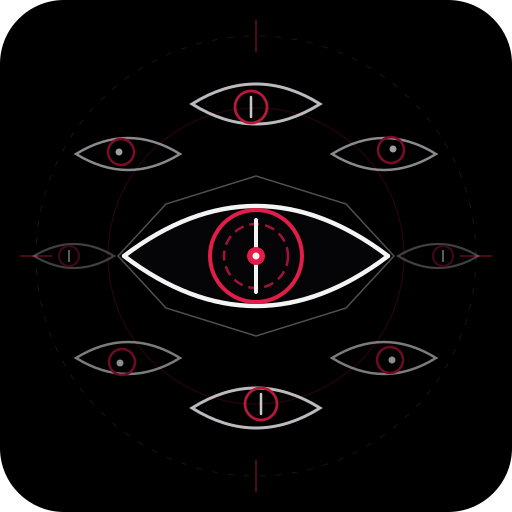

<div align="center">



# PANOPTES v1.0
### Bağımsız On-Device Biyometrik & Derin Açık Kaynak İstihbarat (OSINT) Mobil Platformu
### Standalone On-Device Biometric & Deep Open-Source Intelligence (OSINT) Mobile Platform

<p align="center">
  <a href="#-türkçe-dokümantasyon">
     <b>Türkçe Dokümantasyon (Tam Rehber)</b>
  </a>
  &nbsp;&nbsp;|&nbsp;&nbsp;
  <a href="#-english-documentation">
     <b>English Documentation (Full Guide)</b>
  </a>
</p>


</div>

---

#  Türkçe Dokümantasyon

## 1. Vizyon & Mitolojik Köken (Argos Panoptes)

**Panoptes** (Yunanca: *Πανόπτης*, *"Her Şeyi Gören"*), Yunan mitolojisinde Hera'nın hizmetinde olan, bazıları uyurken diğerleri nöbet tutan **yüz gözlü uyanık dev bekçi Argos Panoptes**'ten ilham alır.

Uygulamanın merkezindeki özel üretim **9-gözlü geometrik SVG amblemi** ([`assets/branding/panoptes_logo.svg`](assets/branding/panoptes_logo.svg)), canlı nefes/bakış animasyonlu `AnimatedPanoptesLogo` bileşeni ve **3-gözlü kompakt ikonu** ([`assets/branding/panoptes_icon.svg`](assets/branding/panoptes_icon.svg)):
- **Simsiyah (`#000000`) Obsidian** arka plan üzerinde,
- Merkezde keskin geometrik konturlu, **Bordo-Kırmızı (`#E11D48` / `#9F1239`)** irisli ve dikey yarık pupilli ana göz,
- Çevresinde farklı boyutlarda, farklı opaklıklarda (derinlik hissi) ve hafif farklı açılara bakan **8 uydu göz** ile tasarlanmıştır.

**Hedef:** Herhangi bir ücretli API anahtarına, sürekli açık bir sunucuya veya harici GPU'ya (RTX 5070 Ti vb.) ihtiyaç duymadan; **tamamen telefon üzerinde (Standalone Edge / Offline-First)** çalışan, fotoğraf + kimlik bilgileriyle **çoklu kaynaktan çapraz sorgu** yaparak en derin herkese açık (Public) OSINT taramasını gerçekleştiren açık kaynaklı mobil istihbarat platformu sunmak.

---

## 2. v1.0 Derin OSINT & Güvenlik Katmanları

### 2.1 Pivot & Keşif Katmanı (Otomatik Varyasyon & Bağlantı Motoru)
- **Username Mutation Engine:** Türkçe karakter normalizasyonu (`ı->i, ğ->g, ü->u, ş->s, ö->o, ç->c`) + noktalı, alt çizgili, baş harfli ve doğum yılı (`98`, `1998`) ekli kullanıcı adı varyasyonlarını otomatik üretir ve çapraz tarar.
- **Email Mutation + Kurumsal Domain Tahmini:** İsim, soyisim, kullanıcı adı ve şirket/üniversite bilgisinden (`ad.soyad@sirket.com.tr`, `adsoyad@gmail.com`, `proton.me` vb.) olası e-posta kombinasyonlarını üretir.
- **Phone Mutation + Operatör İstihbaratı:** `+905xx`, `05xx`, boşluklu, tireli formatlar + Turkcell / Vodafone / Türk Telekom prefix tespiti + doğrudan `wa.me` (WhatsApp) ve `t.me` (Telegram) doğrulama bağlantıları.
- **Recursive Alias Graph Expansion:** Bulunan her yeni nick, GitHub commit e-postası, domain veya konum otomatik olarak 2. ve 3. seviye pivot adayı olur (`Derinlik Sınırı = 3`).
- **Cross-Platform ID Linking:** Aynı Gravatar SHA-256 özeti, aynı GitHub commit e-postası veya aynı 192-D yüz vektörü / `dHash` ile farklı platformlardaki hesapları birbirine bağlar ve **"Çapraz Hesap Korelasyonu: Aynı Kişi Mi?"** skorunu üretir.

### 2.2 Görsel, Biyometrik & Belge Derinliği
- **Multi-Face (Çoklu Yüz) Desteği:** Bir fotoğrafta birden fazla yüz varsa hepsini ayrı ayrı tespit eder ve kullanıcıya **"Hangi Yüz Hedef?"** seçimi sunar.
- **Yaş Aralığı, Baş Açısı & İfade Tahmini:** Cihaz içi mikro-doku gradyanı ve öznitelik sınıflandırması ile yaş aralığı, baş yönelimi (`Euler Y/Z`) ve ifade analizi yapar.
- **Yüz Kalite Skoru + Auto Re-Crop:** `%0–100` biyometrik kalite skoru hesaplar, otomatik merkezleme kırpımı uygular ve düşük açı/ışık durumunda iyileştirme önerisi sunar.
- **Perceptual Hash Kümeleme (`64-bit dHash` & `aHash`):** Aynı kişinin farklı fotoğraflarını ve sosyal medya avatarlarını Hamming mesafesi + `192-D Cosine` ile eşleştirir.
- **Ekran Görüntüsü / Görsel Metin (OCR & Binary String) Çıkarımı:** Görüntü veya ekran görüntüsü içindeki gömülü `@kullanici`, e-posta, telefon ve URL dizgilerini çıkarıp otomatik pivota dönüştürür.

### 2.3 Türkiye + Bölgesel Kamu & Kurumsal Kaynaklar
- **Kamu & Hukuki İlanlar:** T.C. **Resmî Gazete** karar/atama arşivi, **EKAP** kamu ihale bülteni, **İlan.gov.tr & UYAP** açık tebligat/icra/iflas duyuruları.
- **Şirket & Ticaret:** **Ticaret Sicili Gazetesi (TTSG)** ortaklık/yönetim kurulu geçmişi, **MERSİS**, **KAP (Kamuyu Aydınlatma Platformu)** ve **TOBB / Ticaret Odaları**.
- **Akademik & Tez:** **YÖK Akademik** araştırmacı profilleri, **YÖK Ulusal Tez Merkezi**, **Google Scholar**, **ORCID Canlı API** ve **TÜBİTAK / DergiPark**.
- **Plaka & Meslek Odası İstihbaratı:** Notlar veya girdi içindeki `01..81` Türkiye araç plakalarını (`34 ABC 123`) otomatik algılayıp il tescilini çözer; Baro Levhası, TMMOB, TTB ve Taşınmaz/Parsel sorgu matrislerini üretir.
- **Türk Sözlük & Forumları:** Ekşi Sözlük, DonanımHaber, Technopat Sosyal, R10.net, ShiftDelete, Uludağ Sözlük, KızlarSoruyor.

### 2.4 Küresel & Teknik Çoklu Kaynak Çapraz Sorgu (Multi-Source Cross-Querying)
Hiçbir bilgi tek bir kaynağa bağlı kalmaz; her hedef aynı anda paralel protokollerle sorgulanır:
- **Çoklu WHOIS / Domain / Altyapı Zinciri:**
  1. **RDAP (`rdap.org`)** JSON kayıt ve tescil tarihi sorgusu,
  2. **Cloudflare DoH (`1.1.1.1`)** canlı `A`, `MX`, `TXT (SPF/DMARC)`, `NS` sorgusu,
  3. **Google Public DoH (`dns.google`)** ikincil çapraz DNS doğrulaması,
  4. **Certificate Transparency (`crt.sh`)** canlı SSL alt-alan adı (subdomain) keşfi,
  5. **Wayback Machine CDX API (`web.archive.org`)** geçmiş snapshot zaman damgaları,
  6. **TRABİS (`.tr`)** Türkiye alan adı kayıt katmanı.
- **Geliştirici, Sosyal & Akademik Canlı API Yoklamaları:**
  - **GitHub API** + **GitHub Public Events Commit Email Extractor** (commit geçmişinden gerçek e-posta ve isim sızıntısı tespiti!),
  - **GitLab API**, **Keybase API** (kriptografik sosyal medya ve PGP kanıtları), **npm Registry API**, **Crates.io (Rust) API**,
  - **Reddit JSON**, **HackerNews Algolia API**, **Dev.to API**, **Telegram `t.me` Canlı OpenGraph (`og:title` / `og:description`)**, **Chess.com**, **Lichess**, **Wikipedia TR**, **ORCID Public API**.
- **Kripto & Web3 OSINT:** Bitcoin (`bc1...` / `1...` / `3...`), Ethereum/EVM (`0x...`) ve TRON (`T...`) cüzdan adreslerini algılayıp **Mempool.space Canlı API** üzerinden işlem sayısı ve bakiye hareketini sorgular.

### 2.5 OPSEC, Veri Sızıntı Önleme & Anti-Reverse Engineering Kalkanı
- **R8 / ProGuard Tam Kod Gizleme (Obfuscation):** Release APK derlemelerinde sınıf/metot/alan isimleri karıştırılır, semboller ayrıştırılır (`--obfuscate --split-debug-info`) ve kaynak dosya satır tabloları temizlenir.
- **Cihaz İçi Anti-Tamper / Anti-Hook Denetçisi (`MainActivity.kt` MethodChannel):**
  - **Frida (`27042`/`27043` portları ve `/proc/self/maps` bellek haritası)**, **Xposed**, **Substrate** enjeksiyon tespiti,
  - **Root / Magisk / Su** ikili dosya denetimi,
  - **JDWP / Debugger** çalışma zamanı bağlantı kontrolü.
- **FLAG_SECURE Ekran Kalkanı:** Uygulama ekranının üçüncü parti yazılımlarca kaydedilmesini ve son kullanılanlar (Recents) önizlemesinde görünmesini engeller.
- **PV2 Şifreli Yerel Kasa (`SHA-256 Stream + HMAC-SHA256`):** Cihazdaki tüm geçmiş oturumlar ve biyometrik vektörler kimlik doğrulamalı olarak şifrelenir; `android:allowBackup="false"` ile bulut yedek sızıntıları kapatılmıştır.
- **Acil İmha / Tam Sıfırlama (Panic Wipe):** Tek dokunuşla tüm yerel kasayı, önbelleği, aktif dosyayı ve tercihleri kalıcı olarak sıfırlama seçeneği.

---

## 3. Ücretsiz Yöntemler & Fallback Stratejisi Tablosu

| İhtiyaç | Birincil Yöntem (Primary) | Fallback 1 | Fallback 2 |
| :--- | :--- | :--- | :--- |
| **Yüz Tespiti & Çoklu Yüz** | Google ML Kit Multi-Face On-Device | Pure-Dart YCbCr + Bilateral Simetri | Merkez-Ağırlıklı Otomatik Kırpım (`Auto Re-Crop`) |
| **Ters Görsel Arama** | Yandex Images (Yüz odaklı en güçlü) | Google Lens + Bing Visual Search | TinEye + **WebView Recon Köprüsü** (`` DOM yakalama) |
| **Yüz Doğrulama** | Cihaz İçi `192-D Cosine` + `64-bit dHash` | Sosyal Profil Avatarı Otomatik İndirme & Eşleştirme | Yüz Lab Sekmesinde URL / Galeri / Kamera Doğrulama |
| **Domain / WHOIS / DNS** | RDAP + Cloudflare DoH + Google DoH | `crt.sh` CT Log + Wayback CDX API | TRABİS (`.tr`) + Hedefli Altyapı Dorkları |
| **Username & Geliştirici** | GitHub (+Commit Email) + GitLab + Keybase + npm + Crates.io | Telegram OG + Reddit + HN + Dev.to + Chess/Lichess | Hedefli Dork & WebView Köprüsü |
| **Türkiye Kaynakları** | Resmi Gazete + EKAP + İlan.gov.tr + TTSG + YÖK + Plaka | Ekşi + DH + Technopat + R10 + SDN + Uludağ | Google / Yandex / Bing `site:` Operatör Dorkları |
| **E-Posta & Telefon** | Gravatar SHA-256 + DoH MX/TXT + OpenPGP + Holehe Matrisi | E-Posta/Telefon Varyasyon Motoru + Operatör Tespiti | WhatsApp (`wa.me`) & Telegram (`t.me`) + İhlal/Paste Dorkları |

---

## 4. Kurulum, Derleme & GitHub Releases

```bash
# 1. Repoyu klonlayın
git clone https://github.com/MrSpy00/Panoptes.git
cd Panoptes

# 2. Bağımlılıkları yükleyin
flutter pub get

# 3. Statik analiz ve testleri çalıştırın
flutter analyze
flutter test

# 4. Obfuscated Release APK ve Debug APK üretin
flutter build apk --release --obfuscate --split-debug-info=build/app/outputs/symbols
flutter build apk --debug
```

Hazır derlenmiş **Release APK** ve **Debug APK** paketlerini doğrudan [**GitHub Releases**](https://github.com/MrSpy00/Panoptes/releases) sayfasından indirebilirsiniz.

---
---

#  English Documentation

## 1. Vision & Mythological Origin (Argos Panoptes)

**Panoptes** (Greek: *Πανόπτης*, *"All-Seeing"*) draws inspiration from **Argos Panoptes**, the hundred-eyed primordial giant in Greek mythology who served as a tireless watchman.

The custom-crafted **9-eye geometric SVG emblem** ([`assets/branding/panoptes_logo.svg`](assets/branding/panoptes_logo.svg)), live breathing `AnimatedPanoptesLogo` widget, and **3-eye compact icon** ([`assets/branding/panoptes_icon.svg`](assets/branding/panoptes_icon.svg)) feature:
- A pitch-black **Obsidian (`#000000`)** canvas,
- A central sharp geometric eye with a **Crimson-Burgundy (`#E11D48` / `#9F1239`)** iris ring and vertical slit pupil,
- **8 surrounding geometric satellite eyes** at varied scales, opacities, and gaze vectors.

**Objective:** Deliver the deepest possible public Open-Source Intelligence (OSINT) and biometric face verification mobile platform that runs **100% standalone on-device (Edge / Offline-First)** with **zero paid APIs**, parallel multi-source cross-querying, and enterprise-grade OPSEC hardening.

---

## 2. v1.0 Deep OSINT & Security Capabilities

1. **Pivot & Mutation Layer:**
   - **Username Mutation Engine** (Turkish-aware ASCII slugging + birth-year & separator permutations),
   - **Email Mutation & Corporate Domain Guessing**,
   - **Phone Mutation + Carrier Intelligence + Direct WhatsApp/Telegram Links**,
   - **Recursive Alias Graph Expansion (Depth Limit = 3)** and **Cross-Platform ID Linking ("Same Person?" Correlation)**.
2. **Visual, Biometric & OCR Depth:**
   - **Multi-Face Detection & Target Face Selector**,
   - **On-Device Age Range, Head Pose (`Euler Y/Z`), and Expression Estimation**,
   - **Biometric Quality Score (`0–100%`) + Auto Re-Crop**,
   - **Perceptual Hash Clustering (`64-bit dHash` / `aHash` + `192-D Cosine`)**,
   - **Screenshot & Binary Metadata OCR/Pivot Extractor**.
3. **Turkey + Regional Intelligence:**
   - Official Gazette (*Resmî Gazete*), Public Procurement (*EKAP*), Legal Notices (*İlan.gov.tr / UYAP*), Trade Registry (*TTSG*), *MERSİS*, *KAP*, *TOBB*, *YÖK Academic & National Thesis Center*, **Turkish Vehicle License Plate (`01..81`) Resolver**, and major Turkish forums (*Ekşi, DH, Technopat, R10, SDN, Uludağ*).
4. **Global & Technical Multi-Source Cross-Querying:**
   - **Parallel Domain/WHOIS/DNS Stack:** RDAP (`rdap.org`) + Cloudflare DoH (`1.1.1.1`) + Google DoH (`dns.google`) + Certificate Transparency (`crt.sh`) + Wayback CDX (`web.archive.org`) + TRABİS (`.tr`).
   - **Live Developer, Social & Crypto Probes:** GitHub API (+ Public Commit Email Extractor), GitLab, Keybase Cryptographic Proofs, npm Registry, Crates.io, Reddit, HackerNews, Dev.to, Telegram `t.me` OpenGraph, ORCID, and Mempool.space Bitcoin/EVM wallet explorer.
5. **Upfront Extracted Facts, 3 Report Templates & 4 Export Formats:**
   - Every finding card displays a structured **`EXTRACTED CONCRETE FACTS` (`extractedData`)** key-value table upfront before raw links.
   - Supports **Technical**, **Executive Summary**, and **KVKK/GDPR Legal Sanitized** templates exported as **Markdown (`.md`)**, **PDF (`.pdf`)**, **Interactive HTML (`.html`)**, and **JSON (`.json`)**.
6. **OPSEC & Anti-Reverse Engineering Shield:**
   - R8/ProGuard code shrinking & Dart AOT obfuscation, native Android **Frida / Xposed / Root / JDWP Debugger** inspection, `FLAG_SECURE` screen protection, **PV2 (`SHA-256 + HMAC-SHA256`)** authenticated local vault encryption, User-Agent rotation, and one-tap **Panic Wipe**.

---

## 3. Build & Run

```bash
git clone https://github.com/MrSpy00/Panoptes.git
cd Panoptes
flutter pub get
flutter analyze
flutter test
flutter build apk --release --obfuscate --split-debug-info=build/app/outputs/symbols
```

Pre-built **Release** and **Debug** APKs with `SHA256SUMS.txt` are published on [**GitHub Releases**](https://github.com/MrSpy00/Panoptes/releases).
